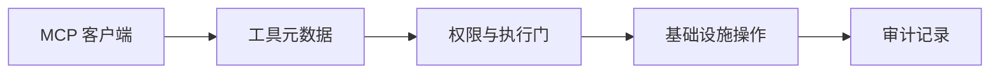

# 具有执行边界的运维工具层 · 工程导读

将 Linux、Docker、Kubernetes 和 SSH 操作封装为 MCP 工具，使客户端可以发现工具，并理解其权限与风险。

## 先理解核心流程



## 值得深入的设计

- 工具目录同时描述类别、风险和所需权限，便于客户端选择工具及开发者审查能力。
- EXECUTE_TOOLS_ENABLED 默认关闭；模块许可、参数或命令检查与审计需要结合实际入口阅读。
- 协议接入和底层执行分离：先验证工具枚举，再逐步接入容器、集群或 SSH 环境。

## 沿源码验证能力

1. **[服务入口](../app/server.py)**：沿此入口检查实际实现与调用关系。
2. **[工具实现](../app/tools)**：沿此入口检查实际实现与调用关系。
3. **[安全控制](../app/security)**：沿此入口检查实际实现与调用关系。
4. **[工具枚举](../scripts/demo_list_tools.py)**：沿此入口检查实际实现与调用关系。
5. **[接入示例](../mcp_config_examples)**：沿此入口检查实际实现与调用关系。
6. **[安全模型](../docs/MCP_TOOL_SECURITY_MODEL.md)**：沿此入口检查实际实现与调用关系。

## 最短运行路线

以下为仓库既有脚本或配置对应的命令。命令以类 Unix Shell 为例，在仓库根目录执行；先准备所需服务和配置，不代表本次文档修改已经完成运行验证。

```bash
python -m pip install -r requirements.txt
python scripts/demo_list_tools.py
```

## 一次演示应验证什么

1. 工具枚举脚本用于查看元数据，不需要连接真实主机；核对输出中的执行开关、工具数量与权限字段。
2. 用配置示例接入 MCP 客户端，先调用健康检查或资源列表等只读工具。
3. 在隔离环境验证执行保护的拒绝路径，再检查审计记录是否包含对应操作。

## 当前边界与复现条件

- 枚举通过只证明工具注册与元数据可读取，不能代替 Docker、Kubernetes 和 SSH 的端到端测试。
- 不以工具数量作为安全结论；权限检查和执行拒绝路径需要单独验证。

## 继续贡献

建议从最小可复现场景开始：描述输入、预期输出、实际结果、运行版本和相关日志，再提交 Issue 或针对对应模块的 PR。测试与性能结果需注明实际执行环境；不要仅根据功能列表推断生产可用性。

[返回项目首页](../README.md)
